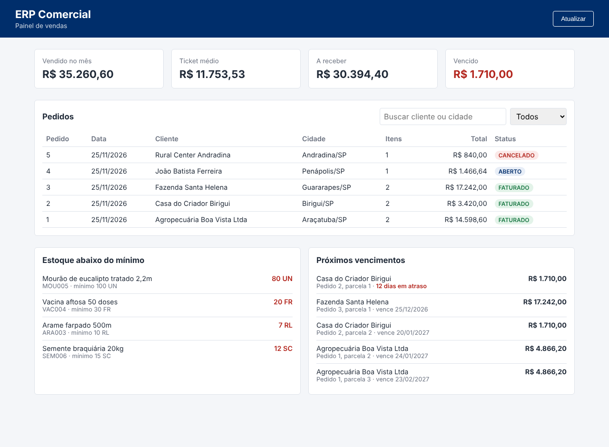

# Agro ERP

Sistema de gestão comercial para uma distribuidora de produtos agropecuários: cadastro de clientes e produtos, pedidos de venda, controle de estoque e contas a receber.

Fiz esse projeto para praticar Delphi com Oracle num cenário parecido com o de um ERP de verdade. A ideia foi deixar as regras de negócio no banco (packages PL/SQL) e usar o Delphi como tela, que é como muito sistema legado funciona por aí.



## O que tem

- **Desktop (Delphi + FireDAC)**: cadastros, pedidos, faturamento, cancelamento e baixa de títulos.
- **Banco (Oracle)**: tabelas, packages PL/SQL com as regras e views para consulta.
- **Painel web (HTML, CSS e JavaScript)**: resumo de vendas, pedidos, estoque crítico e vencimentos. Consome uma API REST feita no ORDS.

### Regras que ficam no banco

- Pedido só aceita item se estiver em aberto, e o preço vem do cadastro do produto.
- Ao faturar: baixa o estoque, verifica o limite de crédito do cliente e gera as parcelas no contas a receber.
- Não deixa vender mais do que tem em estoque (a linha do produto fica travada durante a baixa).
- Cancelar um pedido faturado devolve o estoque e cancela as parcelas, desde que nenhuma tenha sido paga.
- Pagamento parcial é permitido; quando o título é quitado ele muda pra PAGO.

Todo movimento de estoque fica registrado em `movimentos_estoque`, então dá pra saber de onde veio cada entrada e saída.

## Estrutura

```
database/   scripts do Oracle (rodar o instalar.sql)
desktop/    projeto Delphi
web/        painel em HTML/CSS/JS
docs/       imagens do README
```

## Como rodar

### 1. Banco

Precisa de um Oracle 19c ou mais novo. O jeito mais rápido é o Oracle Free no Docker:

```bash
docker run -d --name oracle -p 1521:1521 \
  -e ORACLE_PASSWORD=oracle \
  -e APP_USER=erp -e APP_USER_PASSWORD=erp \
  gvenzl/oracle-free:23-slim-faststart
```

Quando o log mostrar `DATABASE IS READY TO USE!`, rode os scripts com o usuário `erp`:

```bash
cd database
sql erp/erp@localhost:1521/FREEPDB1 @instalar.sql
```

(dá pra usar o SQL*Plus, o SQLcl ou abrir os arquivos no SQL Developer e rodar na ordem)

Isso cria as tabelas, as packages e uns dados de exemplo.

Se for usar um banco que já existe, o usuário precisa de `create table`, `create view`, `create procedure` e `create sequence` (as colunas identity criam sequence por baixo).

### 2. Desktop

- Delphi 11 ou 12 com o driver Oracle do FireDAC. Esse driver só vem na edição Enterprise/Architect, a Community não tem. A versão trial serve.
- Oracle Instant Client instalado. Se compilar em Win32, o Instant Client tem que ser 32 bits.

Copie `desktop/config.ini.exemplo` para a pasta do executável com o nome `config.ini` e ajuste os dados de conexão. Depois é só abrir o `ERPComercial.dpr` e rodar.

### 3. Painel web

Abrindo o `web/index.html` direto no navegador ele já funciona, mas com dados de exemplo (aparece um aviso no topo).

Para ver os dados reais precisa do [ORDS](https://www.oracle.com/database/technologies/appdev/rest.html) apontando para o banco. Com ele rodando:

```bash
sql erp/erp@localhost:1521/FREEPDB1 @database/06_api_ords.sql
```

e confira o endereço em `web/js/config.js`.

## Algumas decisões

- As regras ficam nas packages para valer tanto para o Delphi quanto para a web ou qualquer outra integração. O Delphi faz só uma validação básica antes de chamar.
- Os erros de negócio usam `raise_application_error` com códigos na faixa -20000. No Delphi eu pego a mensagem e mostro sem o "ORA-xxxxx" na frente.
- Usei guard clauses no lugar de `if/else` aninhado. Fica mais fácil de ler o que impede cada operação.
- Os cadastros não são apagados, só inativados, porque têm pedido e título apontando pra eles.

## Ideias pra continuar

- [ ] Relatório de vendas por período
- [ ] Tela de movimentação de estoque com histórico
- [ ] Versão do painel no Oracle APEX
- [ ] Testes das packages com utPLSQL
